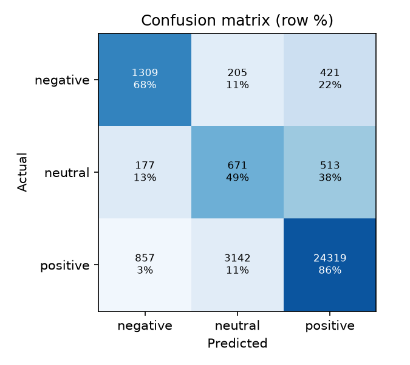

# Bangla Sentiment Analysis (BanglaBook baseline)

Classify Bangla book reviews as **negative, neutral or positive** with a transparent, CPU-only baseline, a command-line tool and a Streamlit app that shows which words drove each prediction.

> **Data license:** the dataset used (BanglaBook) is CC BY-NC-SA 4.0 (non-commercial, share-alike). It is not included in this repository, and neither are trained models. See [NOTICE.md](NOTICE.md).

## 1. Project overview

A TF-IDF (word and character n-gram) + logistic regression pipeline trained on BanglaBook, a dataset of 158,065 Bangla book reviews. It includes Bangla-aware text cleaning, full evaluation (macro-F1, per-class scores, confusion matrix, majority-class baseline) and an explainable prediction view.

## 2. Problem statement

Sentiment tools are mostly built for English. Bangla has far fewer ready-made resources, and its script needs care (vowel signs, digit variants, invisible joiner characters). This project shows an honest, reproducible baseline for Bangla and, importantly, how to judge it fairly on a dataset where about 90% of reviews are positive.

## 3. Features

- Bangla text normalisation (Unicode NFC, invisible characters, Bangla digits, links, repeated punctuation)
- A tokenizer pattern that keeps Bengali words whole (Python's default `\w` splits at vowel signs)
- Training, evaluation and prediction from the command line
- Class-balanced training for the imbalanced data
- Evaluation against a majority-class baseline, with a saved confusion matrix
- Explanations: the words and phrases that pushed a prediction
- Streamlit app with single-text and CSV batch modes, and downloadable results
- 27 automated tests

## 4. Technology stack

Python, scikit-learn, pandas, joblib, matplotlib, Streamlit, pytest. No GPU and no paid services.

## 5. Architecture

```
CSV (Review, label) -> normalize -> TF-IDF words (1-2 grams) + chars (2-4 grams)
                    -> LogisticRegression (balanced) -> probabilities
                    -> explanation = TF-IDF value x class weight, per word feature
```

| File | Role |
|---|---|
| `src/bangla_sentiment/preprocess.py` | text cleaning |
| `src/bangla_sentiment/data.py` | CSV loading and validation |
| `src/bangla_sentiment/model.py` | pipeline, training, scores, explanations, save/load |
| `src/bangla_sentiment/evaluate.py` | metrics, baseline, report files |
| `src/bangla_sentiment/cli.py` | `train`, `evaluate`, `predict` commands |
| `app.py` | Streamlit interface |

## 6. Installation and setup (Windows, PowerShell)

```powershell
git clone <your-repository-url>
cd bangla-sentiment-analysis
py -3.12 -m venv .venv
.venv\Scripts\Activate.ps1
pip install -r requirements.txt
```

Get the data: download or clone https://github.com/mohsinulkabir14/BanglaBook and note the folder `data/csv` (it contains `train.csv`, `validation.csv`, `test.csv`; about 87 MB in total).

## 7. How to run

```powershell
$env:PYTHONPATH = "src"
python -m bangla_sentiment train --data-dir C:\path\to\BanglaBook\data\csv
python -m bangla_sentiment evaluate --data-dir C:\path\to\BanglaBook\data\csv --split test
streamlit run app.py
```

Use `--max-train 20000` for a quick run on a small sample.

## 8. Example usage

```powershell
python -m bangla_sentiment predict "বইটি খুব ভালো লেগেছে, অসাধারণ লেখা"
```

Prints the predicted class, the three class probabilities and the words that supported the prediction. In the app, the Batch tab scores a CSV and lets you download the results.

## 9. Screenshots

The confusion matrix below was generated by this code. App screenshots are not added yet: after you run the app, add real ones to `screenshots/` (single-text result with the explanation table, and the batch tab).



## 10. Testing and evaluation results

**Tests:** `python -m pytest` gives 27 passed on my Linux test environment (Python 3.12). The tests use a tiny hand-written toy dataset to check the code paths; they say nothing about real accuracy.

**Model results**, trained on the full BanglaBook training split (110,645 reviews; about 2 minutes on a 1-core, 4 GB sandbox machine) and scored once on the official test split (31,614 reviews). Validation (15,806 reviews) gave similar numbers.

| | Accuracy | Macro-F1 |
|---|---|---|
| This model (test) | 0.832 | **0.590** |
| This model (validation) | 0.832 | 0.587 |
| Always predict "positive" (test) | 0.896 | 0.315 |

Per class on the test split:

| Class | Precision | Recall | F1 | Reviews |
|---|---|---|---|---|
| negative | 0.559 | 0.676 | 0.612 | 1,935 |
| neutral | 0.167 | 0.493 | 0.249 | 1,361 |
| positive | 0.963 | 0.859 | 0.908 | 28,318 |

How to read this: about 90% of reviews are positive, so predicting "positive" every time scores 0.896 accuracy but never finds a negative or neutral review. This model has lower accuracy because it deliberately trades some positive precision for catching negative and neutral reviews, so **macro-F1 (0.59 vs 0.32)** is the fair comparison. Neutral is the weak spot. These numbers are from a single training run with one fixed set of settings; I did not tune hyperparameters or compare with transformer models.

## 11. Known limitations

- Labels come from star ratings (1-2 negative, 3 neutral, 4-5 positive), not from reading the text, so the data contains label noise. The top-weighted words for the neutral class include some that do not look neutral, which is consistent with this.
- Neutral reviews are poorly detected (F1 0.25).
- Domain: trained on book reviews only; other domains (news, social media) will do worse.
- Bag-of-n-grams cannot understand negation or context well.
- The model file is a Python pickle (joblib); only load files you trained yourself.
- Tested on Linux only; the Windows commands above are untested.

## 12. Future improvements

Fine-tune a Bangla transformer such as BanglaBERT (needs a GPU or a free cloud notebook; BanglaBERT is also CC BY-NC-SA), try threshold tuning for the neutral class, add cross-validation, and evaluate on a second domain.

## 13. Original repository and license attribution

- Dataset: BanglaBook, https://github.com/mohsinulkabir14/BanglaBook, CC BY-NC-SA 4.0. Please cite the BanglaBook paper (Findings of ACL 2023) if you use the data.
- Code: written for this project, MIT License. No code was copied from other repositories.

## My contributions

Everything in this repository is my own implementation (cleaning, tokenizer fix, training and evaluation pipeline, explanations, CLI, app, tests) on top of the public BanglaBook dataset. I did not create the dataset.
